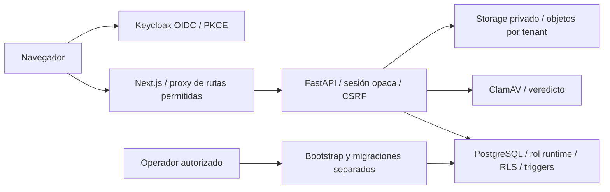

# Auditoría de arquitectura y accesos — 14 noviembre 2026

La fuente entrega una base SaaS con identidad separada de autoridad QMS, empresa aislada por tenant y responsabilidades explícitas por unidad. Hay controles relevantes en API y PostgreSQL, pero no evidencia para declarar seguridad completa, equivalencia funcional completa con Odoo ni preparación para producción. Persisten decisiones de lectura intratenant, profundidad desigual del motor Workflow y ausencia de alta/licencia comercial.

## Alcance y evidencia

- Rama independiente `codex/audit-architecture-access`, base exacta `8133bac47a0731c31738d942f131b17902bb6fe5` (PR41). Solo informe/inventarios/continuidad; sin cambios de producto, permisos, DB real, despliegue, push ni merge.
- Checkpoint previo `CP-ARCH-AUDIT-00-20261114T184050Z`: 505 entradas fuente/Git cifradas; restauración aislada y SHA256 íntegros, bundle verify PASS. Backup/claves fuera de Git. No se afirma restauración DB nueva.
- Inspección de fuente exacta de API, migraciones, proxy y navegación; inventario AST reconciliado con el esquema OpenAPI generado en memoria. Se revisaron directamente los cuerpos de los cuatro getters/locks privilegiados accesibles al runtime.
- Nueva ejecución: **50 unitarias API PASS, 449 integraciones DB omitidas**, dos advertencias de proveedores. Sondas TestClient sin DB: esquema público y caché de identidad sintética. Resultados en [validación](ARCHITECTURE_ACCESS_VALIDATION.json).
- La evidencia de 449 integraciones PostgreSQL PASS y controles de suspensión procede de la entrega PR41 descrita en [TENANT_SUSPENSION.md](../../security/TENANT_SUSPENSION.md); no se presenta como una nueva corrida de esta auditoría. El agente de operabilidad conserva su evidencia independiente.
- No se ejecutó Odoo, navegador, pentest, scanner de dependencias nuevo ni infraestructura de producción. Las declaraciones sobre runtime local son continuidad documentada, no una nueva inspección de su DB.

## Superficie y límites de confianza

El [inventario JSON](ARCHITECTURE_ACCESS_INVENTORY.json) identifica **180 operaciones de negocio en 131 paths**: 71 GET y 109 mutaciones; 176 decoradores más cuatro comandos documentales de fábrica (`documents.py:549–578`). Coinciden exactamente con OpenAPI. Todas las mutaciones declaran CSRF y parámetro autenticado. Son comprobaciones de cableado, no 180 recorridos funcionales ni una prueba de todos los caminos de autorización.

Las operaciones anónimas declaradas son login, callback y health. Además FastAPI mantiene `/openapi.json` anónimo aunque `docs_url` y `redoc_url` sean `None` (`main.py:55`); TestClient devuelve 200. No contiene registros de clientes ni prueba un bypass. La allowlist del proxy Next no incluye esa raíz, de modo que la observación corresponde a acceso API directo, no a exposición comprobada desde el dominio web.

| Capa | Implementado en esta fuente | Límite práctico |
| --- | --- | --- |
| Identidad | OIDC con issuer, nonce, audience única, azp, expiración y firmas RS256/PS256/ES256; state, cookie de binding y PKCE S256 (`oidc.py:96`, `auth.py:110`) | No valida que la organización tenga licencia ni crea membresías comerciales |
| Sesión | Token aleatorio 32 bytes, hash SHA256 en DB, expiración/revocación/usuario activo (`security.py:11`, `auth.py:68`) | Sesión de aplicación propia; cierre/revocación en IdP no equivale automáticamente a revocar las sesiones locales |
| Peticiones | Cookie HttpOnly/SameSite; CSRF cookie+header ligados a sesión; Origin si existe; CORS a web_url exacta (`auth.py:92`, `main.py:61`) | TLS/MFA, rate limiting y controles de borde requieren evidencia de operación; Secure por sí solo no valida endpoints HTTPS |
| Empresa | Tenant de la sesión, no confianza en tenant enviado como autoridad; helper verifica empresa/usuario/membresía activos (`tenant_access.py:24`) | No hay consola comercial de plataforma en la navegación actual |
| SQL | Contexto `app.*` local a transacción, RLS, FK compuestas, triggers y versiones (`database.py:37`) | Las GUC no son identidad criptográfica: API/credenciales runtime son parte del límite de confianza. No entregar SQL directo al usuario |
| Archivos | API exige documents.author/read; PDF hasta20MiB; AV falla cerrado; clave por tenant/doc/revisión; hash+tamaño en descarga (`documents.py:586`, `:671`) | No se inspeccionaron ACL reales S3, cifrado, ciclo de retención ni restauración; firma `%PDF-` no es validación exhaustiva de PDF |
| Infraestructura | Runtime y migrador sin superusuario/BYPASSRLS ni creación de roles (`bootstrap_database.py:47`) | No se inspeccionaron atributos efectivos desplegados ni secretos; diseño de AWS sigue futuro según baseline |

La selección de empresa y la autenticación se mantienen separadas para permitir logout/cambio de empresa tras suspensión. READ COMMITTED revalida sentencias posteriores; no retira datos ya devueltos ni cancela trabajo ya ejecutado. Identidad y sesiones mantienen sus políticas propias, no una excepción para leer negocio suspendido.

## Roles efectivos, unidades y configuración

| Acción | Owner | Admin | Member | Auditor técnico |
| --- | --- | --- | --- | --- |
| Estructura/directorio empresarial, lectura | Sí | Sí | Sí | Sí |
| Estructura/asignaciones, edición | Sí | Sí | No | No |
| Mis grants | Sí; también los de otros | Solo propios | Solo propios | Solo propios |
| Conceder/revocar grants | Sí; sin autoconcesión | No | No | No |
| Bitácora técnica empresarial | Sí | Sí | No | Sí, sin capability de unidad |
| Workflows: leer definiciones/instancias/historia | Sí | Sí | Sí | Sí |
| Workflows: configurar/publicar/iniciar/cancelar | Sí | Sí | No | No |
| Workflow: ejecutar transición | Si asignado | Si asignado | Si asignado | No, incluso si asignado |
| Dominios QMS | Grant explícito por unidad | Grant explícito por unidad | Grant explícito por unidad | Grants de lectura; audits.execute es excepción de preparación, sin ejecución entregada |

Fuentes: `organization_service.py:28`, `organization.py:159,287`, `qms_access.py:130,222`, RLS0008, versión efectiva de `qms_has_capability`/validación en0040, `audit.py:78`, `workflow_service.py:47,579,658`. [JSON de roles/veredictos](ARCHITECTURE_ACCESS_VERDICTS.json).

Los 28 capabilities se conceden a una **unidad exacta**, sin herencia implícita de sede a departamento. Ser lead de unidad, responsable de proceso, propietario de empresa o seat pagado no concede autoridad QMS automáticamente. Auditor técnico de membresía y auditor interno asignado a un expediente son conceptos distintos. La navegación usa familias de capabilities para visibilidad; la autoridad final está en API/DB.

| Empresa cliente puede operar/configurar | Plataforma/proveedor, fuera de la configuración normal |
| --- | --- |
| Estructura, asignaciones de miembros existentes, responsabilidades QMS por owner, procesos/documentos/controles/riesgos/NCR/CAPA autorizados | Aprovisionamiento y suspensión de tenants, identidad/roles DB, secretos, OIDC, backups, despliegues, observabilidad |
| Definiciones/versiones de Workflow empresarial | Catálogo global de planes, precios y normas/ediciones; facturación y soporte autorizado futuros |
| Revisión humana y decisiones que sus permisos permiten | No puede convertir un seat o compra en poder de aprobar; no puede desactivar aislamiento, AV, hashes, historial o CSRF |

Perfil legal/comercial editable, invitaciones, gestión de membresías y consulta/compra de suscripción propia siguen pendientes. No hay endpoint registrado de platform_admin, invitación, licencia, billing ni entitlements. `local_identity_bootstrap.py:208` exige development y usa un contexto administrativo: fixtures no son onboarding.

## Tablas privadas y funciones privilegiadas

Hay **50 tablas ORM** de negocio/identidad y **seis proyecciones privadas** en fuente: 56 tablas de aplicación; el total histórico de57 incluye `alembic_version`. No contar 57 como tablas QMS ni presentar todas como FORCE RLS. Las50runtime tienen diseño FORCE RLS; cinco proyecciones se protegen por ACL sin RLS, y la proyección0047 tiene RLS sin políticas/no FORCE para acceso acotado del propietario. No se consultó catálogo vivo en esta rama.

| Proyección privada | Uso permitido por diseño | Evidencia |
| --- | --- | --- |
| organization_unit_integrity_projection | Integridad jerárquica y locks de unidad/sede; no listado runtime directo | 0004:55,0009:53,0015:41 |
| organization_member_directory_projection | Directorio acotado al tenant y miembros/usuarios activos; conteos de autoridad | 0004:84,0049:32,0047:42 |
| organization_user_directory_projection | Validación/sincronización interna de usuarios | 0004:95,137,218 |
| qms_process_dependency_projection | Impedir archivo de unidad con procesos dependientes | 0009:102–131 |
| qms_process_site_dependency_projection | Dependencias de sedes y restauración | 0015:83–140 |
| qms_audit_execution_grant_projection | Conteos de auditores con grants read+execute, no lista ajena | 0047:14–72 |

Las seis revocan privilegios directos a PUBLIC y pmcloud_app. Se identifican15 funciones SECURITY DEFINER;11 son funciones trigger, cuatro son interfaces invocables previstas. Todas declaran search_path; dos triggers antiguos usan `public,pg_catalog`, con CREATE público revocado por0001 y sin CREATE para runtime. Esto exige preservar ACL/owners y no conceder CREATE a usuarios no confiables.

| Getter/lock invocable | Qué comprueba y revela |
| --- | --- |
| organization_member_directory() | Tenant exacto y actor activo en0049, devuelve user_id/nombre/rol de miembros activos del tenant; conserva lectura amplia A03 |
| lock_qms_process_scope(uuid) | processes.manage para unidad solicitada y unidad activa del tenant; devuelve void/lock, no filas de proyección |
| lock_qms_site_scope(uuid,uuid) | Actor activo en0049, tenant solicitado igual al contexto y sede activa; lock compartido, sin autoridad QMS nueva |
| qms_audit_execution_authority(uuid) | Auditoría del tenant visible y audits.read+audits.review de su unidad; solo planned_auditors/authorized_auditors; no grants individuales ni autorización para iniciar |

`SECURITY DEFINER` no significa getter público sin autorización; tampoco la ausencia de permisos directos elimina la necesidad de revisar su cuerpo. Cambios futuros requieren verificar ACL/owner/search_path, tenant/actor activo, minimización de resultados y pruebas directas con runtime.

## Veredicto sobre auditoría anterior y riesgos

P2/P3 son prioridades de ingeniería de esta revisión, sin CVSS. Las lecturas empresariales amplias necesitan una decisión de producto y minimización; no se califican automáticamente como escape entre empresas. No se demostró escape entre tenants en esta revisión estática; tampoco se afirma ausencia universal de escapes.

| ID | Severidad / estado en base auditada | Evidencia y consecuencia |
| --- | --- | --- |
| A01 | P2, corregido en fuente y probado antes; **no aplicado en runtime local** | Helper escalar API,11restrictivas0049, directorio/lock sede reforzados. DB local documentada0048; no atribuir protección nueva a la app que sigue ejecutando0048 |
| A11 | P3, corregido en fuente y probado antes; **no aplicado en runtime local** | `audit.py:105` private,no-store; no equivale a política uniforme para toda API |
| A02 | P2, vigente en este baseline; desarrollo separado aún no funcional | `qms_access.py:223` limit100 y UI carga array. Owner puede no encontrar grants antiguos para revocar; navegación de100 locales no resuelve completitud |
| A03 | P2, decisión de lectura pendiente | `organization.py:287`, directorio0049 y UI QMSAccess:57 cargan nombres/roles/unidades incluso para Mis accesos. Minimizar consultas y definir pickers por caso |
| A04 | P2, decisión de lectura pendiente | `audit.py:78` owner/admin/auditor empresarial, sin capability/unidad. Separar auditor interno y auditor de seguridad exige diseño explícito |
| A05 | P2, vigente | `workflow_service.py:459` valida que usuario exista, sin excluir auditor; publicación permite destinatario que `:666` rechaza al ejecutar. Riesgo de tareas publicadas imposibles |
| A06 | P2, defensa SQL pendiente | Política `workflow_instances_update`0005:319 permite UPDATE a cualquier miembro activo;0049 añade actividad, no asignación/transición/versión/evento. API sí valida. No demuestra bypass HTTP; falta profundidad SQL equivalente a dominios nuevos |
| A07 | P2, arranque comercial pendiente | Owner no se autoconcede; no flujo de invitación/segundo owner. Mantener segregación y diseñar bootstrap/alta de autoridad revisable |
| A08–A10 | P3, siguen parciales | Navegación confusa, listas Workflow100/editor/mensajes inciertos y caminos UI de controles incompletos; evidencia original y fuente, sin nueva aceptación browser aquí |
| B01 | P3, caché sensible sin política API general | Solo4módulos contienen Cache-Control. `/auth/me` sintético200 no trae cabecera; proxy API reenvía upstream y middleware Next excluye `/api`. Adoptar política explícita para identidad y JSON de negocio; no se observó almacenamiento real ni fuga |
| B02 | Informativo, superficie API | `/openapi.json` directo200 sin autenticación, pese a docs/redoc desactivados. Decidir exposición consciente; esquema público no otorga acceso a datos |
| B03 | Bloqueo operativo previo a producción, no fallo nuevo demostrado | TLS/MFA/secretos/roles efectivos/restauración/DAST/pentest/gates CI requieren evidencia. `config.py:46` solo valida Secure+clave en production; no basta para certificar despliegue |

La auditoría anterior [ACCESS_CONFIGURATION_AND_PARITY_AUDIT.md](../../product/reviews/2026-11-14/ACCESS_CONFIGURATION_AND_PARITY_AUDIT.md) describe PR39/DB0048. Su cierre «A01–A11 pendientes» es histórico: en base PR41 A01/A11 ya tienen implementación y pruebas aisladas, pero no despliegue local. A02 permanece en trabajo separado `codex/qms-access-history`; esta rama no integra ni afirma ese trabajo como entregado. El resto no se da por cerrado por el arreglo de suspensión.

## Capacidad implementada y deuda funcional

| Capacidad reconocible en código | Límite que permanece |
| --- | --- |
| Identidad, selección de empresa, estructura y grants explícitos | Alta empresarial/personas, segundo autorizador y licencia comercial ausentes |
| Procesos, documentos/revisiones/comandos/upload AV/descarga hash | No sustituye todas las variantes, importación ni aceptación de cliente Odoo |
| Controles, actividades, evidencia/revisión | UI de no aplicabilidad y evidencia requerida no completa todos los caminos API |
| Riesgos, NCR, CAPA/análisis/acciones/revisión/relaciones | Debe verificarse recorrido integrado completo y orígenes con casos de uso concretos |
| Workflows genéricos versionados y Centro de Acciones | No configuran los comandos de aprobación documental/NCR/CAPA; referencia libre no es integración gobernada |
| Auditorías: programa/plan/alcance/criterios/equipo/agenda/independencia/autoridad/competencia | `ready_for_execution: Literal[False]` en `internal_audit_independence.py:84`; no ready/start, ejecución, evidencia/hallazgos, hallazgo→NCR, reporting/cierre entregados |
| Bitácora append-only | Autoridad de lectura amplia pendiente; no es el módulo de auditoría interna de calidad |

No existen verticales completas de KPI/objetivos, revisión por dirección, personas/formación general, calibración, cliente/proveedor/8D/SCAR, costos, importación general, packs/versiones ISO ni implementación guiada. La competencia puntual del auditor no reemplaza formación corporativa. No se generan certificados ni se incluyen textos ISO licenciados por citar una norma.

La idea del usuario de Básico=1empresa+3seats+1ISO consta como propuesta comercial; precio/edición/extras y enforcement no están implementados. Empresa=tenant; sedes/departamentos=unidades. Otra empresa necesita contexto aislado, no una unidad extra con registros compartidos. El formulario comercial de seats genera un brief y declara que no es suscripción (`product-enquiry.ts:78`).

El conteo previo Odoo de menús/botones es un inventario estático de exposición funcional; no es prueba de equivalencia integral ni porcentaje de producto. La revisión presente no recalcula ese conteo ni afirma haber ejecutado Odoo.

## Orden recomendado y criterios de cierre

1. Aplicar0049 solo después de respaldo DB restaurado y revisión/gates del head destinado a desplegar. Confirmar runtime/API/migración reales; ningún checkpoint de fuente reemplaza ese control.
2. Terminar paginación/búsqueda de grants con pruebas de revocación por todo el historial; cerrar el caso Workflow auditor-only y fortalecer comandos SQL de instancias/versiones/eventos.
3. Decidir lectura por función/unidad para directorio, trazabilidad y catálogos; implementar sin ampliar autoridad QMS ni depender de ocultar menús. Unificar política de caché sensible.
4. Diseñar alta de empresa/membresías/autoridad inicial y entitlements por tenant/seats/ISO, sin convertir compra en aprobación ni eliminar self-grant por conveniencia.
5. Completar lifecycle y ejecución de auditorías con revalidación atómica, después verticales pendientes; validar flujos de cliente y operación segura antes de declarar paridad o publicar.

Este orden es recomendación de ingeniería. No añade decisiones comerciales ni permisos del usuario. La entrega es un diagnóstico verificable; no certificación, pentest ni autorización de producción.

## Validación de secretos del inventario

Gitleaks señaló cuatro checksums SHA256 de fuentes del baseline como generic-api-key (ocho alertas al incluir las dos copias del commit local/remoto en refs compartidas). Cada valor se recalculó contra el blob exacto de PR41. Se añadió una excepción únicamente para esos cuatro valores, esa regla y el path exacto del inventario; no se excluye el archivo ni se desactiva detección de credenciales. El inventario no contiene secretos ni configuraciones privadas.
