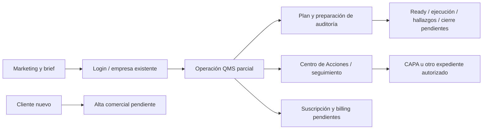

# Auditoría del recorrido completo — 14 noviembre 2026

El recorrido tiene tramos verificables de marketing, navegación y operación QMS, pero **no llega desde un cliente nuevo hasta un QMS cerrado y facturado**. Faltan alta comercial, invitaciones/autoridad inicial, ejecución y cierre de auditorías, suscripción/licencias y billing. Un recorrido con datos demo existentes no resuelve esas ausencias.

## Alcance y separación de evidencia

Rama independiente `codex/audit-complete-flow`, base exacta `8133bac47a0731c31738d942f131b17902bb6fe5` (fuente PR41). El frontend de prueba corre en3103; el callback OIDC autorizado sigue regresando a3000 y la API real es8000. El preview3103 comparte host y puede leer sesiones del entorno local, pero no es un despliegue nuevo ni un entorno de producción.

La DB real continúa documentada en0048. No se aplicó0049 ni se cambiaron esquema, grants o registros QMS. Los arreglos de suspensión/caché de PR41 no se atribuyen a ese runtime. No se ejecutó Odoo ni se probó una instalación de cliente.

| Evidencia | Qué comprueba | Qué no comprueba |
| --- | --- | --- |
| Frontend real, sin autenticación | Marketing, tabs/teclado, validación de solicitud de demo, descarga del brief y límite de login | Envío de email, onboarding o contrato |
| OIDC local y GET de negocio | Se consigna por separado en matriz/resultados; solo cuenta cuando el runtime responde y la sesión se verifica | Creación/edición/aprobación QMS, cambio de empresa por POST o suspensión0049 |
| Browser con identidad/API en memoria | **115 casos distintos PASS:114 regresiones existentes +1 vínculo Centro de Acciones→CAPA**; sin retries/skips | Backend real, RLS, firma humana, AV/S3, licencia o certificación |
| Pruebas API/SQL aisladas de módulos | Se entregan en la rama de operabilidad; no se suman a los PASS de browser | No convierten la prueba de pantalla en una transacción distribuida completa |

Los fixtures de browser responden las operaciones en memoria e interceptan cualquier escritura no reconocida. No cargan credenciales ni crean sesiones reales. Se sustituyó exclusivamente el import del helper de autenticación en copias temporales de tres suites; sus114 casos originales mantienen las aserciones. El caso adicional comprueba identificadores de CAPA/unidad/proceso al navegar desde seguimiento. [Resultados y hashes de fuentes](FLOW_FIXTURE_RESULTS.json).

## Estado operativo observado

La evidencia inicial heredada contenía5PASS de marketing/roles sintéticos y2FAIL de login por timeout al buscar `#username`. No contenía una sesión persistida ni evidencia de11 módulos reales completados. Se conservó en [resultados iniciales](FLOW_BROWSER_INITIAL_RESULTS.json), sin reclasificar esos fallos como éxito.

A las20:38UTC, `/health` devolvió503 con PostgreSQL unavailable, S3 y antivirus ok; `/auth/login` devolvió500 antes de mostrar Keycloak. Esa condición explica los dos timeouts iniciales: no demuestra credenciales incorrectas ni un selector roto. La recuperación del servicio la gestiona el agente principal; esta auditoría no borra contenedores, imágenes o volúmenes ni modifica DB. [Sondas y disponibilidad](FLOW_RUNTIME_AVAILABILITY.json).

La corrida final termina con **3PASS públicos reales +2PASS de navegación de roles sintéticos +1BLOCKED de OIDC/lecturas reales**; no se sometieron credenciales ni se completaron11 módulos reales. El estado final de OIDC/lecturas y sus límites aparece en [resultados de browser](FLOW_BROWSER_RESULTS.json) y [matriz](COMPLETE_FLOW_MATRIX.json). Los tramos bloqueados por infraestructura se distinguen de funciones que no existen.

## Recorrido y puntos de corte

| Tramo | Resultado verificable / límite |
| --- | --- |
| Marketing → entender producto | Página/products real; tour cambia por teclado, FAQ y navegación funcionan;320px y1440px sin overflow ni violaciones axe en los casos inspeccionados |
| Solicitud de demo | Company/seats/ISO construyen un brief; seats0 bloquea email/descarga, seats3 habilita; destinatario correcto y TXT descargable. **No se abrió cliente de correo ni se envió mensaje** |
| Alta de empresa/personas | **BLOCKED funcional**: no existe asistente de onboarding/invitación/segundo autorizador. `/onboarding`404 y ausencia de rutas API comerciales; bootstrap development no es alta del cliente |
| Login → empresa existente | Usa únicamente identidad demo autorizada y GET cuando la infraestructura está disponible. Empresa seleccionada por la sesión existente/alta previa; no se concede autoridad nueva |
| Procesos | Lectura/navegación real solo cuando consta en resultados finales. No se crea un proceso real. Tener pantalla no valida un mapa completo del sistema del cliente |
| Documentos | Browser aislado:16 casos de referencias, paginación, revocación/errores y comandos/upload inciertos o rechazados. Los veredictos de archivo son simulados; prueba API/SQL/AV/S3 simulada pertenece a operabilidad |
| Controles/evidencia | Navegación real condicionada al registro final; no se fabrican evidencias reales. La UI sigue sin todos los caminos de no aplicabilidad/evidencia requerida descritos en la auditoría de accesos |
| Riesgos/NCR → CAPA |13 casos aislados: filtro por fuente/unidad, apertura de CAPA exacta, creación en memoria con fuente/proceso fijados,503 conserva borrador,403 limpia contexto, resultado incierto bloquea replay, paginación y lectura tardía. No hay creación QMS real |
| Investigación/acciones/revisión CAPA | Implementación y pruebas API de dominio se revisan en operabilidad; esta rama no ejecuta la aprobación/efectividad/cierre reales de un expediente de cliente |
| Auditorías: plan → preparación |85 casos aislados: programa/plan, alcance, criterios, equipo, agenda, independencia, autoridad y competencia; conflictos/versiones/denegación/replay/maquetación. Un expediente planned no autoriza ejecución |
| Preparación → ready/start | **BLOCKED funcional**: `ready_for_execution: Literal[False]` en `internal_audit_independence.py:84`; UI y contrato no entregan los comandos ready/start |
| Ejecutar auditoría → evidencia/hallazgos → NCR → reporte/cierre | **BLOCKED funcional**: no hay rutas de esos comandos en el OpenAPI runtime inspeccionado; no se inventan evidencias/hallazgos ni se afirma un cierre completo |
| Seguimiento → expediente exacto | Caso adicional aislado Centro de Acciones→CAPA preserva UUID de expediente, unidad y proceso, muestra detalle correcto y no escribe backend;375px/axePASS. Lectura real/cola real se identifica aparte |
| Licencia/suscripción/billing | **BLOCKED funcional**: OpenAPI sin licencia/subscription/billing; web/billing404 y API/billing404. No se compra, factura, renueva ni aplica límite comercial de seats/ISO |

La tabla no es un porcentaje de paridad. La aplicación admite operaciones parciales útiles, pero no reemplaza las verticales pendientes de KPI, revisión de dirección, formación general, calibración, calidad cliente/proveedor, costos o importación. Los textos/certificaciones ISO no se obtienen por marcar una casilla comercial.



## Regresiones y capturas reproducibles

Desde la raíz del worktree, con dependencias ya instaladas y el preview de Next disponible en3103:

```sh
'/Users/Gerdel_Garcia/Documents/ChatGPT/SaaS QMS PerfectMatchSystems/scripts/with-local-tools.sh' node docs/audits/2026-11-14/run-flow-fixture-regressions.mjs
```

El runner materializa las suites en un directorio temporal, conserva hashes de las fuentes, instala un adaptador de identidad/API en memoria y excluye los casos `live `. La versión final incluye115 casos. Los resultados de esta entrega proceden de114 originales y una corrida dirigida del caso adicional; no se inventa una única corrida115. `FLOW_FIXTURE_GREP` y `FLOW_FIXTURE_OUTPUT` permiten repetir un caso en otro directorio sin sobrescribir evidencia anterior.

El [script de lectura/marketing](flow-browser-audit.mjs) comprueba `/health` antes del login; si la DB no está disponible registra BLOCKED y no envía credenciales. Acepta `FLOW_WEB_URL` y `FLOW_API_URL`. Las credenciales demo autorizadas, si se usan, se proporcionan solo por entorno fuera de Git; no se imprimen ni se guardan storageState/tokens. Todos los POST/PUT/PATCH/DELETE del proxy quedan interceptados en las etapas de lectura. El callback crea únicamente una sesión de autenticación normal.

Capturas representativas, identificadas por tipo de evidencia:

- [Marketing real, desktop](screenshots/marketing-desktop.png).
- [Límite de entrada anónimo, móvil](screenshots/login-mobile.png).
- [Seguimiento sintético,375px](screenshots/synthetic-follow-up-mobile.png) → [detalle CAPA sintético](screenshots/synthetic-follow-up-capa-detail.png).
- [Preparación/competencia sintética, desktop](screenshots/synthetic-audit-competence-desktop.png) y [plan sintético móvil oscuro](screenshots/synthetic-audit-planning-mobile-dark.png).

Se inspeccionaron visualmente marketing, seguimiento móvil y preparación/competencia desktop. Las verificaciones axe/overflow se limitan a los estados y tamaños ejecutados; no son certificación WCAG ni pentest. Los overlays/indicadores de desarrollo de Next no forman parte de un build de producción.

## Recuperación, entrega y trabajo pendiente

Checkpoint inicial del agente anterior `CP-FLOW-AUDIT-00-20261114T184358Z`; relevo `CP-FLOW-HANDOFF-00-20261114T203403Z` restaura509 entradas fuente/Git, hashes y bundlePASS. Las evidencias finales incluyen JSON, scripts y capturas bajo docs; los resultados completos y logs de los fixtures quedan en artifacts, con hashes en el manifiesto. Backups/claves se mantienen fuera del árbol.

Solo se entregan documentos, JSON, scripts de regresión de auditoría y capturas. Los archivos autogenerados de Next se preservan fuera del commit y se normalizan a la base al cerrar el preview. No hay cambios de producto, grants, membresías, datos QMS reales, migración0049, producción, push ni merge.

Para cerrar el recorrido comercial hacen falta decisiones e implementación de alta/autoridad inicial, entitlements y billing. Para cerrar el recorrido de calidad faltan ejecución/hallazgos/reporte/cierre de auditorías y las verticales señaladas. Después se requiere aceptación con actores distintos, datos controlados y backend/AV/storage reales en un entorno autorizado. Ningún fixture sustituye esas pruebas.
